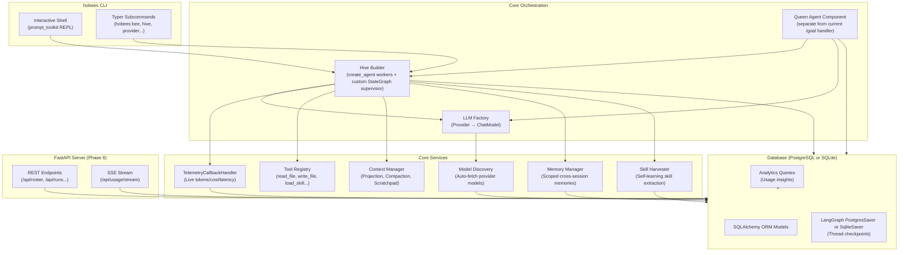
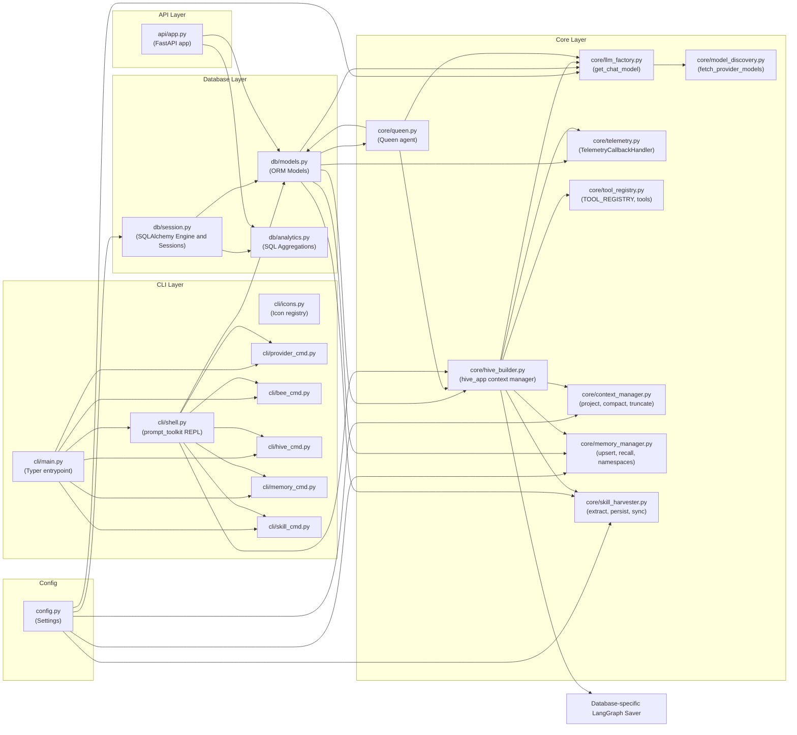
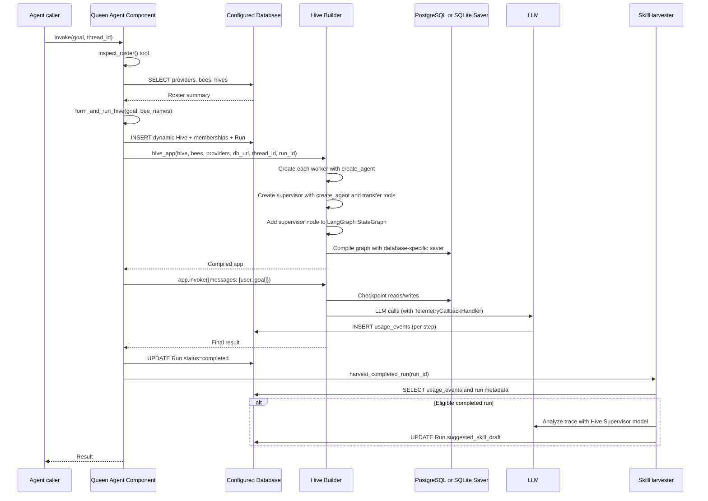
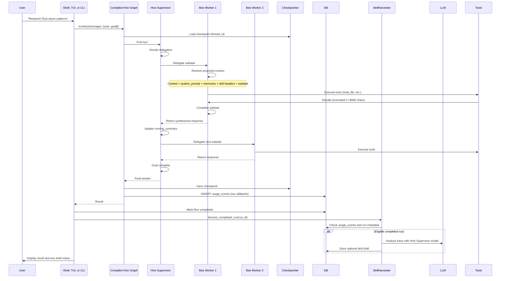
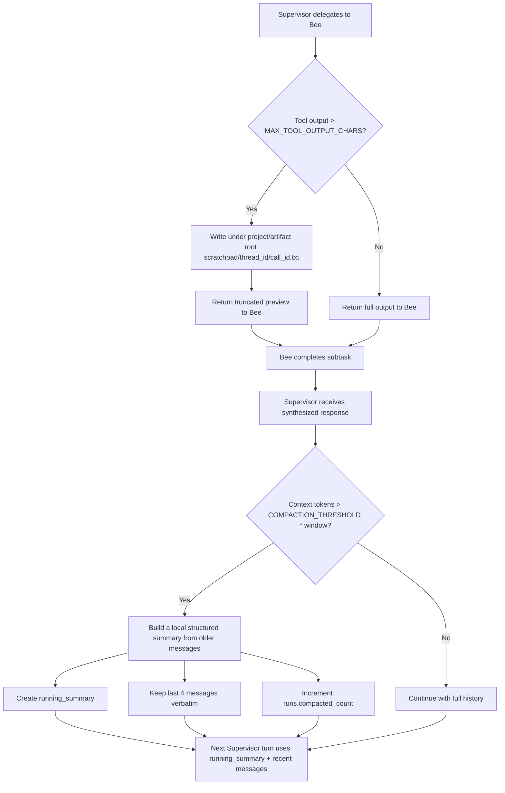
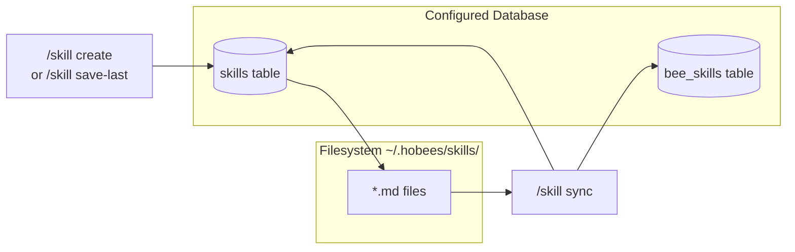
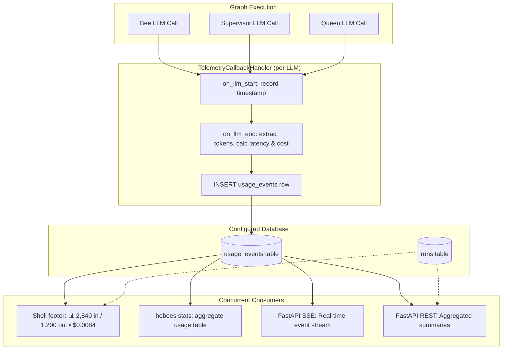
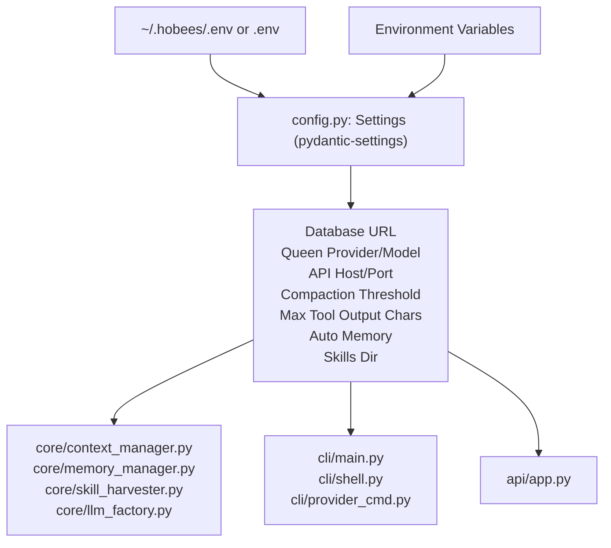
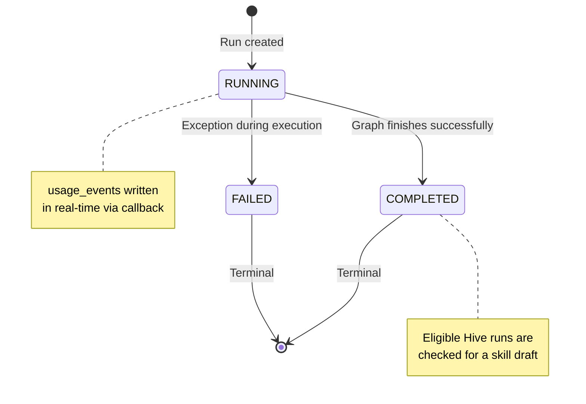
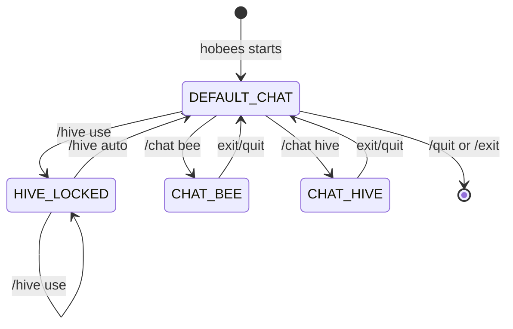

# Code Design Documentation

This document describes the architecture, data flow, and design patterns of the hobees codebase at multiple levels of abstraction.

---

## Level 1: System Architecture (High-Level)



### Key Architectural Distinction: Two Orchestration Layers

| Layer | Component | Role |
|-------|-----------|------|
| **Meta-Orchestration** | **Queen agent component** | Inspects the roster and can create a new dynamic Hive; not invoked by the current shell `/goal` handler |
| **Hive Orchestration** | **Hive Supervisor** | Delegates subtasks to worker bees within a specific hive; configured per-hive with own provider/model/prompt |

> **Important:** Neither the Queen nor the Hive Supervisor are "bees." They are orchestration agents that route and synthesize. Worker bees execute tools; supervisors only delegate.

---

## Level 2: Component Architecture

### 2.1 Core Module Dependency Graph



---

### 2.2 Database Schema (ER Diagram)

```mermaid
erDiagram
    LLM_PROVIDER ||--o{ BEE : "provides"
    LLM_PROVIDER ||--o{ HIVE : "supervises"
    BEE }|--o{ HIVE : "memberships"
    HIVE ||--o{ RUN : "executes"
    RUN ||--o{ USAGE_EVENT : "generates"
    RUN ||--o| SKILL : "suggests"
    BEE }|--o{ SKILL : "assigned"
    
    LLM_PROVIDER {
        int id PK
        string alias UK
        string provider_type
        string base_url
        string api_key_env
        string default_model
        decimal input_cost_per_1m
        decimal output_cost_per_1m
        int context_window_tokens
        json available_models
        timestamp models_refreshed_at
        timestamp created_at
    }
    
    BEE {
        int id PK
        string name UK
        text role_description
        text system_prompt
        int provider_id FK
        string model_name
        float temperature
        string thinking_level
        json tool_names
        timestamp created_at
    }
    
    HIVE {
        int id PK
        string name UK
        text goal_description
        int supervisor_provider_id FK
        string supervisor_model_name
        text supervisor_prompt
        string supervisor_thinking_level
        boolean is_dynamic
        string project_path
        timestamp created_at
    }
    
    HIVE_MEMBERSHIPS {
        int hive_id FK
        int bee_id FK
        text role_override
        PK (hive_id, bee_id)
    }
    
    RUN {
        int id PK
        string thread_id UK
        int hive_id FK
        string mode
        text goal
        string status
        timestamp started_at
        timestamp completed_at
        int compacted_count
        json suggested_skill_draft
    }
    
    USAGE_EVENT {
        bigint id PK
        int run_id FK
        string thread_id
        string bee_name
        string provider_alias
        string model_name
        int input_tokens
        int output_tokens
        decimal estimated_cost_usd
        int latency_ms
        json tool_calls
        timestamp created_at
    }
    
    MEMORY {
        int id PK
        string namespace
        string key
        text content
        string source_thread_id
        timestamp updated_at
        UK (namespace, key)
    }
    
    SKILL {
        int id PK
        string name UK
        text description
        text instructions
        json tags
        string source_thread_id
        int usage_count
        timestamp created_at
        timestamp updated_at
    }
    
    BEE_SKILL {
        int bee_id FK
        int skill_id FK
        PK (bee_id, skill_id)
    }
```

---

## Level 3: Execution Flow Diagrams

### 3.1 Queen Agent Component Flow



This sequence describes the `Queen` agent implementation. The current shell
`/goal` handler builds and runs a dynamic Hive directly; it does not invoke
the Queen agent. When `Queen.form_and_run_hive()` is invoked, it always creates
a new dynamic Hive from selected Bees; it does not execute or reuse an existing
static Hive.

---

### 3.2 Hive Execution Flow (Targeted Mode - Hive Orchestration)



---

### 3.3 Context Efficiency Engine Flow



---

## Level 4: Key Design Patterns

### 4.1 Lazy Imports on Execution Paths

```python
# cli/main.py - representative top-level imports
import typer
from rich.console import Console

# Database and execution services are imported inside handlers.
# CLI command modules are also imported at module load.
@app.callback()
def _root(ctx: typer.Context, ...):
    if ctx.invoked_subcommand is None:
        # Heavy imports happen HERE when shell actually starts
        from hobees.db.session import get_engine, session_scope
        from hobees.db.models import LLMProvider
        from hobees.cli.shell import _shell_loop
        _shell_loop(ctx.obj)
```

There is no measured cold-start performance target. Some database, model, and
API imports are deferred to command execution, while CLI command modules are
imported when the entrypoint loads.

**Applied in:** `cli/main.py`, `core/llm_factory.py`, `core/hive_builder.py`, `core/telemetry.py`

---

### 4.2 Database-Specific Checkpointing

```python
# core/hive_builder.py
@contextmanager
def hive_app(hive, bees, providers, db_url, thread_id, run_id, thinking_override):
    """Yields a compiled graph with its checkpoint connection open."""
    if backend is sqlite:
        if database is file-backed:
            with SqliteSaver.from_conn_string(path) as saver:
                yield graph.compile(checkpointer=saver)
        else:
            yield graph.compile(checkpointer=MemorySaver())
    else:
        with PostgresSaver.from_conn_string(conn_string) as saver:
            compiled = graph.compile(checkpointer=saver)
            yield compiled  # saver stays open during graph execution
```

`HOBEES_DATABASE_URL` selects both the SQLAlchemy application database and the
LangGraph checkpoint backend. File-backed SQLite checkpoints persist in the
SQLite database; in-memory SQLite checkpoints are temporary. Hive tool output
is written beneath the active project/artifact root, typically
`artifacts/<hive>/scratchpad/<thread_id>/<call_id>.txt`.

**Applied in:** `hive_app()`, `hive_app_async()`, shell/TUI chats

---

### 4.3 Callback Handler for Cross-Cutting Concerns

```python
# core/telemetry.py
class TelemetryCallbackHandler(BaseCallbackHandler):
    def __init__(self, bee_name, provider_alias, model_name, thread_id, run_id, rates):
        self.bee_name = bee_name
        self.rates = rates  # provider -> (input_cost, output_cost)
    
    def on_llm_start(self, serialized, prompts, *, run_id, **kwargs):
        self._starts[str(run_id)] = time.monotonic()
    
    def on_llm_end(self, response, *, run_id, **kwargs):
        latency_ms = (time.monotonic() - start) * 1000
        input_tokens, output_tokens = _extract_tokens(response)
        cost = self._estimate_cost(input_tokens, output_tokens)
        
        # Immediate DB write - visible to other terminals/API
        self._insert(run_id, input_tokens, output_tokens, cost, latency_ms)
```

**Applied in:** `TelemetryCallbackHandler` attached to every Bee and Supervisor LLM

---

### 4.4 State Projection (Worker Context Isolation)

```python
# core/context_manager.py
def project_worker_context(bee_name, bee_role, bee_system_prompt, 
                           bee_skills, memories, running_summary, subtask):
    """Worker receives ONLY what it needs - not raw message history."""
    parts = [
        f"# System Prompt\n{bee_system_prompt}",
        f"\n# Your Role\n{bee_role}",
        f"\n## Known Context & Preferences\n" + format_memories(memories),
        f"\n## Available Skills\n" + format_skill_headers(bee_skills),
        f"\n## Conversation Summary\n{running_summary}",
        f"\n## Your Task\n{subtask}",
    ]
    return "\n".join(parts)
```

**Result:** Bees operate with ~200-500 tokens context instead of full conversation history.
The Hive builder currently passes no `running_summary` to worker context projection;
the optional parameter remains available to other callers.

---

### 4.5 Bi-Directional Markdown Sync (Skills)



---

## Level 5: Data Flow - Telemetry Pipeline



---

## Level 6: Configuration & Settings Flow



---

## Level 7: Module Responsibility Matrix

| Module | Responsibility | Key Exports |
|--------|----------------|-------------|
| `config.py` | Application settings via pydantic-settings | `settings` (Settings instance) |
| `db/session.py` | SQLAlchemy engine and session management | `get_engine()`, `session_scope()`, `dispose_engine()` |
| `db/backends.py` | Validate supported database URLs and normalize PostgreSQL checkpoint URLs | `get_database_backend()`, `get_postgres_checkpoint_url()` |
| `db/models.py` | SQLAlchemy ORM models matching schema | `LLMProvider`, `Bee`, `Hive`, `Run`, `UsageEvent`, `Memory`, `Skill`, `BeeSkill` |
| `db/analytics.py` | Fast SQL aggregations for usage insights | `summary()`, `active_runs()`, `recent_events()`, `run_thread_usage()` |
| `core/llm_factory.py` | Resolve provider rows → LangChain ChatModels with thinking_level | `get_chat_model()`, `resolve_api_key()`, `ThinkingLevel` |
| `core/telemetry.py` | LangChain callback writing usage_events per LLM step | `TelemetryCallbackHandler` |
| `core/tool_registry.py` | Built-in @tool functions, registry, truncation wrapper | `TOOL_REGISTRY`, `get_tools()`, `get_skill_metadata()`, `set_thread_context()` |
| `core/hive_builder.py` | Compile Hive StateGraph (Supervisor + Workers) with checkpointer | `hive_app()` context manager |
| `core/queen.py` | Queen Meta-Orchestrator agent with DB tools | `Queen`, `build_queen()`, `QUEEN_PROMPT` |
| `core/model_discovery.py` | Auto-fetch models from local/remote providers | `fetch_provider_models()` |
| `core/context_manager.py` | Worker projection, tool truncation, compaction | `project_worker_context()`, `truncate_tool_output()`, `compact_messages()` |
| `core/memory_manager.py` | Scoped memory CRUD + prompt injection | `upsert_memory()`, `build_memory_block()`, `extract_namespaces()`, `save_memory`, `recall_memory` |
| `core/skill_harvester.py` | Heuristic-based skill draft extraction for completed Hive runs and Markdown sync | `should_harvest()`, `harvest_completed_run()`, `extract_skill_draft()`, `persist_skill()`, `sync_skills_from_markdown()` |
| `cli/main.py` | Typer entrypoint, init, stats, serve, prompt, shell | `app` (Typer), `init()`, `stats()`, `serve()`, `prompt()` |
| `cli/shell.py` | prompt_toolkit REPL with slash-command router | `_shell_loop()` |
| `cli/icons.py` | Unicode/ASCII icon registry with fallback | `APP`, `BEE`, `HIVE`, `QUEEN`, `SUCCESS`, `WARN`, `ERROR`, `MEMORY`, `SKILL`, `COMPACT`, `THINKING` |
| `cli/provider_cmd.py` | Provider CRUD + model discovery + interactive picker | `cmd_provider_add()`, `cmd_provider_list()`, `cmd_provider_models()`, `interactive_model_picker()` |
| `cli/bee_cmd.py` | Bee CRUD + thinking level | `cmd_bee_create()`, `cmd_bee_list()`, `cmd_bee_update()`, `cmd_bee_thinking()` |
| `cli/hive_cmd.py` | Hive CRUD + membership + thinking level | `cmd_hive_create()`, `cmd_hive_add_bee()`, `cmd_hive_thinking()` |
| `cli/memory_cmd.py` | Memory CRUD across namespaces | `cmd_memory_list()`, `cmd_memory_add()`, `cmd_memory_forget()`, `cmd_memory_show()` |
| `cli/skill_cmd.py` | Skill CRUD + assign + Markdown sync | `cmd_skill_list()`, `cmd_skill_create()`, `cmd_skill_save_last()`, `cmd_skill_assign()`, `cmd_skill_sync()` |
| `api/app.py` | FastAPI REST + SSE endpoints | `create_app()` (FastAPI factory) |

---

## Level 8: State Machines

### 8.1 Run Status Lifecycle



### 8.2 Shell Mode State



---

## Level 9: Concurrency & Safety

### 9.1 Database Concurrency

```python
# db/session.py
def get_engine() -> Engine:
    global _engine
    if _engine is None:
        options = {"pool_pre_ping": True, "echo": False}
        if database_backend == "postgresql":
            options.update(pool_size=5, max_overflow=10)
        _engine = create_engine(
            settings.database_url,
            **options,
        )
    return _engine
```

PostgreSQL supports concurrent access from the CLI, `hobees stats`, and the
FastAPI server.

PostgreSQL is recommended when multiple processes or terminals share the
database. SQLite is supported for local use; concurrent writes can contend
because of SQLite's write-locking behavior. Both application tables and
LangGraph checkpoints use the database selected by
`HOBEES_DATABASE_URL`. SQLite uses the SQLAlchemy dialect's default pool
settings; PostgreSQL uses the configured pool size and overflow.

---

### 9.2 Thread-Local Context for Tool Truncation

```python
# core/tool_registry.py
_thread_local = threading.local()

def set_thread_context(thread_id: str, call_id: str | None = None):
    _thread_local.thread_id = thread_id
    if call_id:
        _thread_local.call_id = call_id

def truncate_tool_output(output, call_id, thread_id):
    # Uses thread-local if not passed explicitly
    ...
```

---

## Level 10: Extension Points

| Extension Point | Location | How to Extend |
|-----------------|----------|---------------|
| **Custom Tools** | `core/tool_registry.py` | Add `@tool` function, register in `TOOL_REGISTRY` |
| **Custom Providers** | `core/llm_factory.py` | Add `elif ptype == "custom":` branch in `get_chat_model()` |
| **Custom Thinking Mapping** | `core/llm_factory.py` | Extend `_apply_thinking_level()` for new provider types |
| **Custom Memory Namespaces** | `core/memory_manager.py` | Add prefix to `extract_namespaces()` validation |
| **Custom Skill Hooks** | `core/skill_harvester.py` | Modify `should_harvest()` criteria or `extract_skill_draft()` prompt |
| **Custom Analytics** | `db/analytics.py` | Add new SQL queries in `summary()` with new `group_by` values |
| **Custom API Endpoints** | `api/app.py` | Add new FastAPI routes |
| **Custom Slash Commands** | `cli/shell.py` | Add to `_COMMANDS` dict and handler function |

---

## Summary: Architectural Principles

1. **Selective Lazy Imports** - Some database and execution imports are deferred until command execution; no cold-start timing is guaranteed
2. **Selectable SQL Database** - PostgreSQL for shared multi-process use or SQLite for local use
3. **Callback-Based Telemetry** - Cross-cutting concerns (tokens, cost, latency) via LangChain callbacks
4. **Context Efficiency** - Projection, truncation, compaction, progressive loading to control token growth
5. **Bi-Directional Sync** - Skills synced between the configured database and Markdown files
6. **Completed-Run Skill Drafts** - Eligible completed Hive runs are analyzed and drafts remain subject to user approval
7. **Session Override Pattern** - Thinking level and tool approval level: session → saved global setting (`HOBEES_APPROVAL_MODE`) → context default (`interactive` on a TTY, `strict` headless)
8. **Shared Handlers** - CLI and shell slash commands use identical handler functions

---

## Clarification: Queen vs. Hive Supervisor

| Aspect | Queen Meta-Orchestrator | Hive Supervisor |
|--------|------------------------|-----------------|
| **Scope** | Global (all providers, bees, hives) | Single hive (its member bees) |
| **Triggers** | Queen agent invocation; the shell `/goal` handler currently runs its own dynamic-Hive path | Targeted mode (`/hive use` + chat/goal) |
| **Tools** | `inspect_roster()`, `form_and_run_hive()` | Delegation to worker bees only |
| **Creates** | A new dynamic Hive on each `form_and_run_hive()` call | Executes within existing Hive |
| **Config** | Own provider/model (`QUEEN_PROVIDER`, `QUEEN_MODEL`) | Per-hive (`supervisor_provider_id`, `supervisor_model_name`) |
| **Is a Bee?** | **No** - separate orchestration agent | **No** - separate orchestration agent |

The term "Queen" refers to a separate agent implementation; the current shell
`/goal` handler does not invoke it. Hives have **Supervisors**, not queens.
Worker bees are the only "bees" that execute worker tools.